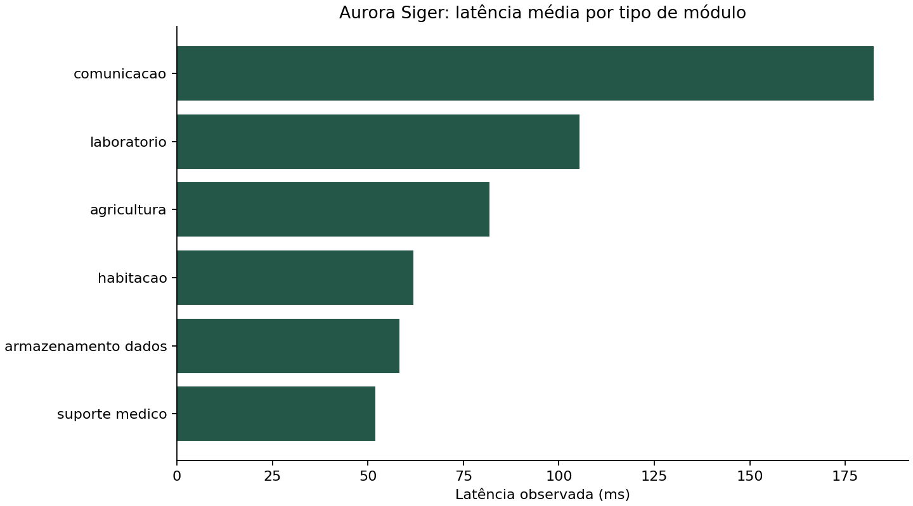
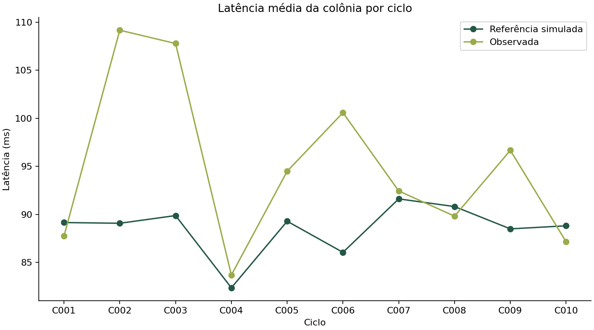
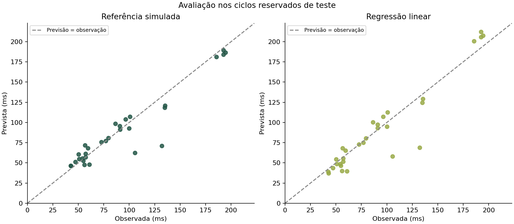

# Relatório técnico - SCIC Aurora Siger

## 1. Contexto e funcionamento

O Sistema de Comunicação Interplanetária da Colônia organiza leituras da Aurora Siger, analisa confiabilidade das estimativas, coloca ocorrências numa fila de atendimento e permite localizar registros por prefixo. O fluxo implementado é **CSV > validação e limpeza > indicadores > previsão e avaliação > heap > trie > relatório e gráficos**. O arquivo principal é `codigo_fonte.py`, com menu de terminal e demonstração automática `--demo`.

Os tempos em milissegundos representam enlaces locais e relés simulados da colônia. Eles **não representam o atraso de propagação Terra-Marte**. A comunicação interplanetária é contextualizada como envio assíncrono de mensagens priorizadas, com armazenamento até a disponibilidade do enlace; esse canal externo e seus atrasos não foram fisicamente modelados. Nenhum sensor real, API externa ou comando de controle é utilizado.

Foram integrados os perfis de módulos e a geração de dados existentes, os cálculos numéricos e a estrutura de busca trie. A solução acrescenta validação de registros, modelo treinado, partições temporais, métricas, heap explícito, menu único, exemplos executados e discussão técnica conectada aos resultados.

## 2. Dados, limpeza e consultas

O gerador fornecido usa semente NumPy 42 e perfis de 15 módulos: Antena Central Aurora, Relay Orbital Siger-1 e Siger-2, Núcleo de Dados Alfa e Beta, Habitação Norte e Sul, Estufas Hidropônicas 1 e 2, Laboratórios Geológico e Biológico, Enfermaria Central, Bloco Cirúrgico, Depósito Criogênico e Oficina de Manutenção. A análise desta execução contém **15 módulos** e **10 ciclos**: C001, C002, C003, C004, C005, C006, C007, C008, C009, C010.

Cada leitura possui os 14 campos abaixo. `numero_ciclo` e as colunas de erro são derivados após a leitura.

O gerador preserva perfis de latência nominal, ruído, tensão, corrente, prioridade e deriva por módulo. Introduz interferência em aproximadamente 4% dos eventos e manutenção em aproximadamente 6%, por sorteio reproduzível. Também insere seis latências ausentes, dez campos de status com caixa/espaços alterados e quatro reenvios para exercitar a limpeza. No status original do simulador, o desvio absoluto dividido pela referência nominal acima de 10% gera alerta, e acima de 25% gera mensagem de desvio elevado. Essa regra difere da classificação analítica de erro relativo, que usa a observação no denominador.

| Campo | Significado |
| --- | --- |
| id_registro | Identificador inteiro da leitura; reenvios idênticos são deduplicados |
| ciclo / data_registro | Ciclo Cnnn e data no formato AAAA-MM-DD |
| nome_modulo / tipo_modulo | Módulo e área operacional da colônia |
| codigo_sensor | Identificador hexadecimal SNS-0xNNNN |
| latencia_prevista_ms | Referência simulada disponível antes da medição; não é saída da regressão |
| latencia_observada_ms | Latência observada simulada, alvo da regressão |
| tensao_v / corrente_a / potencia_w | Grandezas elétricas simuladas em V, A e W |
| status | ativo, manutencao ou alerta informado pelo simulador |
| prioridade | Criticidade do módulo: 1 essencial, 5 menor prioridade |
| mensagem_alerta | Descrição textual do estado do enlace |

| Resultado da carga | Quantidade |
| --- | --- |
| linhas_originais | 154 |
| duplicatas_removidas | 4 |
| registros_rejeitados | 6 |
| registros_validos | 144 |
| modulos | 15 |
| ciclos | 10 |

Espaços e caixa são padronizados; números, datas, códigos, prioridades e associações sensor-módulo são validados. Reenvios idênticos são removidos. IDs com conteúdos conflitantes são recusados, pois escolher uma versão arbitrária ocultaria a ambiguidade. Leituras faltantes ou inválidas ficam em `resultados/leituras_rejeitadas.csv` com motivo, fora das métricas e do treinamento, e entram na fila como falhas de qualidade. Elas não são substituídas por médias.

As consultas combinam nome de módulo, status e prioridade. A busca textual é literal, sem executar caracteres do usuário como expressões regulares.

| Tipo | Registros | Módulos | Latência média (ms) | Potência média (W) | Alertas informados (%) |
| --- | --- | --- | --- | --- | --- |
| comunicacao | 28 | 3 | 182,509 | 136,225 | 17,857 |
| laboratorio | 30 | 3 | 105,375 | 63,944 | 20,000 |
| agricultura | 19 | 2 | 81,795 | 51,895 | 36,842 |
| habitacao | 18 | 2 | 61,899 | 42,748 | 33,333 |
| armazenamento_dados | 30 | 3 | 58,219 | 57,275 | 33,333 |
| suporte_medico | 19 | 2 | 51,981 | 83,528 | 15,789 |

O tipo **comunicacao** apresenta a maior latência média. Uma latência nominal maior não implica, isoladamente, falha: cada observação precisa ser comparada à sua referência. A coluna `status` descreve a regra do simulador; a classificação de erro e a severidade da fila são cálculos diferentes, documentados nas próximas seções.

## 3. Indicadores, erro absoluto e erro relativo

Definições: `erro_absoluto_ms = |previsto - observado|`, `desvio_ms = previsto - observado` e `erro_relativo = erro_absoluto_ms / |observado|`. A referência do erro relativo é a observação. Latências abaixo de 1 ms recebem erro relativo **indefinido**, evitando divisão por zero ou por denominadores próximos de zero. O erro absoluto continua disponível.

| Indicador | Valor |
| --- | --- |
| latencia_media_ms | 94,958 |
| latencia_p95_ms | 192,543 |
| erro_absoluto_medio_ms | 11,118 |
| erro_absoluto_mediano_ms | 4,635 |
| erro_absoluto_maximo_ms | 277,650 |
| erro_relativo_medio_pct | 8,726 |
| erros_criticos | 21,000 |
| degradacoes_criticas | 9,000 |
| alertas_informados | 37,000 |
| manutencoes | 8,000 |
| leituras_relativo_indefinido | 0,000 |

Os limites escolhidos para esta simulação são: até 5% aceitável, acima de 5% até 15% atenção, acima de 15% crítico. Eles são hipóteses operacionais do projeto e exigiriam calibração com requisitos reais. Um erro crítico significa baixa aderência da previsão; só é marcado como **degradação crítica** quando a latência observada também é maior que a referência. Uma latência menor pode revelar uma estimativa ruim sem significar um enlace mais lento.

O erro absoluto médio de **11,118 ms**, a mediana de **4,635 ms** e o máximo de **277,650 ms** mostram que poucos desvios grandes podem influenciar a média. O ranking por erro percentual inicia pelo módulo **Habitacao Sul**; consulte `resultados/erros_por_modulo.csv` para verificar o valor e se o relativo é definido. Esse ranking direciona a investigação da referência e das leituras, sem provar uma causa física.

### Precisão numérica e potência

`0.1 + 0.2` produz `0.30000000000000004`. A igualdade exata com 0,3 é falsa; `math.isclose` retorna verdadeiro. A soma simples das latências é `13673.99` e `math.fsum` produz `13673.99`. `fsum` reduz erro de acumulação, mas não torna medições físicas exatas. Arredondamos apenas na exibição, preservando a precisão interna dos erros e das métricas.

A menor latência é **38,850 ms**. A resolução de 0,01 ms admite até 0,005 ms de arredondamento, equivalente a **0,01287%** dessa leitura. O desvio percentual mediano é **5,066%**. Ele é maior que o limite de arredondamento dessa resolução; o arredondamento sozinho não explica o desvio típico.

Na verificação `P = V x I`, **144 de 144** registros são coerentes. A diferença máxima é **0,033800 W**. A tolerância é propagada a partir das resoluções registradas: `0,005*|I| + 0,0005*|V| + 0,005*0,0005 + 0,005 W`. Isso considera o arredondamento de tensão, corrente e potência em vez de uma igualdade exata entre floats.

## 4. Modelo simples e avaliação de performance

A regressão linear de scikit-learn estima `latencia_observada_ms` usando somente `latencia_prevista_ms` e `numero_ciclo`. A primeira é uma referência nominal simulada, conhecida antes da leitura; a segunda representa a evolução do ciclo. Status, erro, potência calculada a partir da medição e latência observada não entram como atributos. Assim, resultados do próprio evento não vazam para a previsão.

| Partição | Ciclos | Registros |
| --- | --- | --- |
| treino | C001, C002, C003, C004, C005, C006 | 86 |
| validacao | C007, C008 | 28 |
| teste | C009, C010 | 30 |

A separação ocorre por ciclos completos, em ordem cronológica, com aproximadamente 60% para treino, 20% validação e 20% teste. O código recusa datas sobrepostas entre ciclos. A regressão é inicialmente ajustada só no treino. Na validação comparamos seu RMSE com o da referência original. O método escolhido é **referência simulada**. Depois, a regressão é reajustada em treino mais validação, e os dois métodos são avaliados nos mesmos registros de teste. O teste não decide qual método utilizar.

| Partição | Método | MAE (ms) | MSE (ms²) | RMSE (ms) | R² |
| --- | --- | --- | --- | --- | --- |
| validacao | regressao linear | 14,346 | 439,899 | 20,974 | 0,784 |
| validacao | referencia | 5,624 | 49,088 | 7,006 | 0,976 |
| teste | regressao linear | 11,229 | 299,761 | 17,314 | 0,864 |
| teste | referencia | 9,380 | 243,066 | 15,591 | 0,890 |

MAE é o erro absoluto médio em ms; MSE é a média dos erros ao quadrado em ms²; RMSE é a raiz do MSE, em ms, com maior influência dos erros grandes; R² compara a soma dos erros quadráticos com a variação do alvo em torno da própria média. R² não informa causalidade nem garante ausência de erros críticos. Para alvo constante ou amostra unitária, mostramos R² indefinido.

A regressão não reduziu o RMSE no teste em relação à referência, nesta amostra. Na regressão, o MAE do teste é **11,229 ms** e o RMSE é **17,314 ms**. A distância entre essas métricas deve ser interpretada junto dos desvios individuais e do gráfico de teste, sem declarar precisão perfeita ou generalização para uma rede real. A comparação no teste é descritiva; a escolha continua sendo a feita na validação.

O modelo ajustado tem intercepto **-6,017112** e coeficientes **1,212282** para a referência e **-1,274120** para o ciclo. As estimativas do próximo ciclo estão em `resultados/estimativas_proximo_ciclo.csv`, usando o método escolhido e mantendo a referência mais recente de cada sensor. São extrapolações simuladas de um ciclo, sem intervalo de confiança e sem comando automático. Previsões não positivas são sinalizadas como fisicamente inválidas, sem correção silenciosa.

Não foi necessário aplicar Grid Search, Random Search, AIC, BIC ou métodos iterativos: a regressão usada não tem hiperparâmetros pesquisados, o objetivo é uma comparação operacional simples e não um estudo de seleção por verossimilhança ou uma simulação dinâmica física. Essas extensões não são requisitos obrigatórios desta entrega.

## 5. Priorização com heap

A fila contém **76 ocorrências** desta execução, incluindo falhas de telemetria. Cada objeto `Alerta` armazena ID do registro, módulo, ciclo, nível do evento, prioridade do módulo, idade em ciclos, erro relativo e motivo. A chave do min-heap é `(nivel, prioridade_modulo, -idade_ciclos, -erro_relativo)`, seguida de contador de inserção para desempate FIFO.

Nível 1 atende degradações críticas e leituras inválidas; nível 2 atende alertas informados, outros desvios relevantes e relativo indefinido. Dentro do nível, prioridade 1 protege módulos essenciais; em seguida, registros mais antigos e de maior erro saem antes. Leituras válidas em manutenção programada não geram alertas operacionais; continuam nas consultas e métricas. Falhas de qualidade permanecem na fila, inclusive se o registro indicava manutenção.

O primeiro alerta é o registro **12**, de **Relay Orbital Siger-1**, ciclo **C002**, nível **1** e prioridade do módulo **1**. Motivo: Latência maior que a referência com erro relativo acima de 15%.

| Ordem | ID | Módulo | Ciclo | Nível | Prioridade | Idade |
| --- | --- | --- | --- | --- | --- | --- |
| 1 | 12 | Relay Orbital Siger-1 | C002 | 1 | 1 | 8 |
| 2 | 16 | Relay Orbital Siger-1 | C006 | 1 | 1 | 4 |
| 3 | 127 | Bloco Cirurgico | C007 | 1 | 1 | 3 |
| 4 | 23 | Relay Orbital Siger-2 | C003 | 1 | 2 | 7 |
| 5 | 24 | Relay Orbital Siger-2 | C004 | 1 | 2 | 6 |
| 6 | 66 | Habitacao Sul | C006 | 1 | 2 | 4 |
| 7 | 56 | Habitacao Norte | C006 | 1 | 2 | 4 |
| 8 | 69 | Habitacao Sul | C009 | 1 | 2 | 1 |

`FilaAlertas.inserir` coloca o item no fim e executa heapify-up, comparando com o pai. `retirar` troca a raiz pelo último item e executa heapify-down, escolhendo o menor filho. Inserir e retirar custam O(log n), consultar a raiz O(1). Uma lista não ordenada exige O(n) para localizar o mais urgente a cada atendimento. O vetor interno **não é uma lista totalmente ordenada**: ele mantém a propriedade pai <= filhos. A opção 5 mostra esse vetor e a ordem obtida por retiradas de uma cópia; a opção 8 retira da fila da sessão.

A fila representa um backlog simulado dos ciclos históricos. Retiradas são atendimentos em memória e não comprovam solução de falhas físicas. Recarregar a base reconstrói o backlog, e o relatório usa uma fila completa nova para preservar a reprodutibilidade da análise.

## 6. Busca por prefixo com trie

A trie foi conectada à base válida e indexa nomes de módulos, códigos de sensores, tipos de módulo e mensagens. Cada termo contém os IDs das leituras associadas. Normalizamos caixa e acentos para a consulta, preservando a grafia original para apresentação.

| Prefixo executado | Termos encontrados |
| --- | --- |
| com | comunicacao |
| SNS-0x1A0 | SNS-0x1A01, SNS-0x1A02, SNS-0x1A03, SNS-0x1A04, SNS-0x1A05, SNS-0x1A06, SNS-0x1A07, SNS-0x1A08, SNS-0x1A09, SNS-0x1A0A, SNS-0x1A0B, SNS-0x1A0C, SNS-0x1A0D, SNS-0x1A0E, SNS-0x1A0F |
| enf | Enfermaria Central |

Após seguir os caracteres do prefixo, a busca visita apenas sua subárvore; ela não varre todos os registros da colônia. A descida custa O(p), para p caracteres; enumerar resultados depende da subárvore visitada e dos termos emitidos. Há ordenação dos filhos na travessia para exibição alfabética e limite de 20 termos. Isso não é uma promessa de tempo constante nem significa que listar todos os sensores seja gratuito. Prefixo vazio não retorna a base inteira. No menu, os IDs encontrados podem ser usados para consultar as leituras correspondentes.

## 7. Entrada, saída, bases numéricas e eletricidade

Entrada implementada: CSV com leituras de sensores simulados e comandos digitados no teclado. Saída implementada: terminal, CSVs analisados, JSON de métricas, gráficos PNG e este relatório. Conceitualmente, medidores poderiam transmitir pacotes por uma interface de rede ou USB para um computador local; rádio e relés fariam o transporte entre segmentos. Essas interfaces não são controladas pelo programa.

Exemplo calculado da leitura do módulo **Antena Central Aurora**: sensor **SNS-0x1A01**, hexadecimal **0x1A01**, decimal **6657**, binário de 16 bits **0001101000000001**. O identificador mantém o mesmo valor nas três bases; a base muda a representação, não a identidade do sensor.

Tensão de **48,380 V** e corrente de **2,244 A** resultam em `P = V x I =` **108,56472 W**. A resistência equivalente `R = V/I` é **21,560 ohms**. Esse R é uma equivalência de cálculo da leitura, sem afirmar que o transmissor real seria um resistor puramente ôhmico. A potência calculada representa consumo elétrico aproximado, não potência de radiofrequência irradiada. Sem duração de transmissão, não inferimos energia em Wh nem economia energética medida.

## 8. Gerenciamento inteligente da comunicação

As **6 leituras rejeitadas** indicam a necessidade de detectar ausência de pacotes, conferir alimentação e confirmar a coleta. Sensores e medidores inteligentes poderiam alimentar continuamente as mesmas colunas do CSV. A fila mantém essas falhas visíveis ao operador, em vez de ocultá-las no descarte estatístico.

O monitoramento dos erros por ciclo e do módulo **Habitacao Sul**, junto das **9 degradações críticas**, pode orientar inspeção de enlace, antena ou referência nominal. Desvio de latência não identifica sozinho qual equipamento falhou. A regressão e a comparação com a referência oferecem evidência para acompanhamento; não são um sistema de manutenção preditiva validado em falhas reais.

O primeiro alerta da fila direciona o atendimento conforme as regras documentadas. Automação poderia notificar a equipe e solicitar confirmação; comutação de enlace ou desligamento de cargas exigiria supervisão e validação adicionais. As **8 leituras em manutenção** ajudam a separar intervenções programadas dos demais eventos.

Os relés Siger-1 e Siger-2 e os núcleos Alfa e Beta fornecem candidatos conceituais à redundância e armazenamento temporário. O protótipo consulta seus registros, mas não simula failover nem prova que esses componentes sejam independentes. Dados de latência, disponibilidade e potência poderiam fundamentar testes futuros de comutação e store-and-forward.

Numa microrrede elétrica da Aurora Siger, medições V, I e P ajudariam a coordenar alimentação de transmissores e módulos essenciais. A rede de comunicação levaria comandos e medições dessa microrrede, enquanto a disponibilidade de energia sustentaria os enlaces. O SCIC fornece indicadores para esse planejamento; controle de geração, baterias e distribuição não foi implementado.

## 9. Responsabilidade social, diversidade e sustentabilidade

**Uso responsável dos recursos:** a fila pode orientar o envio primeiro de mensagens essenciais e a investigação de retransmissões desnecessárias. A potência das leituras apoia o dimensionamento de consumo, mas a base não mede número de retransmissões, duração de envio ou energia economizada. Não declaramos uma redução percentual de desperdício sem medição.

**Conhecimentos tradicionais e respeito à natureza:** a gestão de água das estufas e de energia dos enlaces pode ser discutida com comunidades e especialistas, reconhecendo conhecimentos indígenas específicos sobre cuidado e limites dos recursos. Uma adaptação real exigiria participação, consentimento e reconhecimento de autoria, sem tratar povos diversos como uma cultura única nem atribuir a eles a origem dos algoritmos.

**Diversidade cultural:** a prioridade é associada à função operacional do módulo, não a origem, identidade ou grupo das pessoas. Moradias Norte e Sul precisam de critérios verificáveis de atendimento. Respeitar culturas indígenas e afro-brasileiras inclui representação nas decisões, revisão da linguagem de mensagens e atenção a necessidades distintas de acessibilidade, sem estereótipos.

**Transparência e supervisão humana:** chave de prioridade, motivo de rejeição, atributos da regressão, métricas e limitações ficam acessíveis no terminal e nos arquivos. Erros maiores em habitação ou agricultura não autorizam excluir suas mensagens nem concluir que seus usuários têm menor importância. A equipe humana deve avaliar contexto, revisar critérios e assumir responsabilidade por decisões operacionais. O SCIC não faz decisões sobre direitos ou elegibilidade de pessoas.

## 10. Limitações e melhorias específicas

A base distribuída é pequena, sintética e cobre dez ciclos, com ruído e falhas controlados pelo gerador. Não há hardware, comunicação real com a Terra, autenticação, serviço persistente de atendimento, causalidade de falhas ou previsão probabilística. A regressão usa dois atributos e pode falhar diante de interferências raras ou mudanças de comportamento. O limiar fixo de 15% e as prioridades devem ser revistos com a equipe da colônia. Uma decisão de classificar erro como crítico não substitui uma investigação técnica.

Melhorias: ampliar ciclos e eventos; acrescentar disponibilidade e perda de pacotes; realizar validação temporal em múltiplas janelas; calibrar limites por módulo sem desfavorecer habitações; avaliar incerteza; persistir atendimentos e justificativas; testar redundância com cenários de falha independentes; medir duração e energia para avaliar sustentabilidade com números observados.

## 11. Evidências e reprodução

Execute `python codigo_fonte.py --demo` para reproduzir leitura, consulta, erros, modelo, heap, trie, conversão de bases, eletricidade, gráficos e relatório. Use `python codigo_fonte.py` para explorar o menu e `python -m unittest discover -s testes -v` para executar os testes. As dependências e versões estão em `requirements.txt`; o ambiente validado é Python 3.12.

Os arquivos em `resultados/` são saídas da execução distribuída, não valores ilustrativos digitados manualmente: `resumo_execucao.json`, `dados_analisados.csv`, `leituras_rejeitadas.csv`, `previsoes_teste.csv`, `estimativas_proximo_ciclo.csv`, `indicadores_por_tipo.csv`, `erros_por_modulo.csv` e `exemplo_execucao.txt`. O registro `testes.txt` contém a saída dos testes executados para esta entrega.

O vídeo será gravado e publicado pelo aluno responsável. `link_video.txt` identifica essa etapa pendente; nenhum link fictício foi incluído. A publicação como Não listado e o preenchimento da URL real devem ocorrer antes da submissão final na plataforma.
