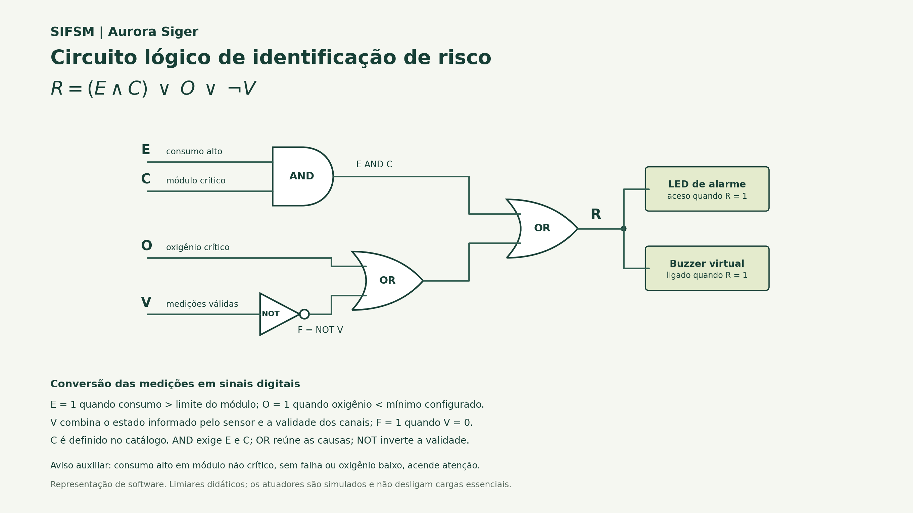

# Parte 2 - Circuito lógico, sensores e estruturas de dados

Esta parte está integrada ao projeto Python/SQLite pela função **`parte2_regras.executar(conn)`**, chamada pela **opção 6** do menu original. A conexão recebida é a mesma da Parte 1.

## Utilizar pelo menu do grupo

```bash
python main.py
```

Escolha **6 - Regras lógicas, alertas e estruturas de dados**. O programa mostra as últimas leituras de consumo/oxigênio e oferece:

1. Reanalisar os dados atuais do banco.
2. Registrar novos alertas calculados.
3. Consultar a fila de alertas não resolvidos.
4. Mostrar a tabela-verdade completa.
0. Voltar ao menu principal.

Para criar ou alterar medições, use o CRUD do menu principal e depois reanalise na opção 6. Os alertas gravados aparecem na entidade **Alertas** do mesmo CRUD. A análise isolada não escreve no banco; a gravação ocorre apenas na opção correspondente.

## Correspondência com o banco existente

| Informação da regra | Origem no banco |
| --- | --- |
| Código, tipo, unidade e atividade | Tabela `sensores` |
| Nome e criticidade do módulo | Tabela `modulos`, ligada por `sensores.modulo_id` |
| Valor e horário | Último registro de `leituras`, por `data_hora DESC, id DESC` |
| Alertas calculados | Tabela existente `alertas` |
| Origem, prioridade exata e deduplicação | Tabela auxiliar `parte2_eventos`, criada ao gravar |

O tipo `consumo` fornece somente o canal de energia; `oxigenio` fornece somente o canal de oxigênio. Um canal não cadastrado não é interpretado como falha. Os tipos `umidade`, `temperatura` e os demais permanecem disponíveis no CRUD, mas ficam fora desta regra.

O modelo interno usa um identificador `BD-S<id>` para cada sensor, preservando o código original no campo `origem.sensor_codigo` e nas mensagens. Isso permite respeitar códigos de texto que já tenham sido cadastrados pela Parte 1.

## Regra e circuito

```text
R = (E AND C) OR O OR (NOT V)
F = NOT V
```

| Sinal | Significado |
| --- | --- |
| E | Consumo válido maior que o limite configurado |
| C | Módulo crítico, a partir do campo `modulos.critico` |
| O | Oxigênio válido menor que o mínimo configurado |
| V | Sensor ativo, unidade/data válidas e medição admissível nos canais monitorados |
| F | Falha de validade |
| R | Alarme crítico; LED e buzzer virtuais ligados |



O limite integrado inicial é **50 kWh por leitura de consumo** e o mínimo é **19,5%**. Ambos são hipóteses didáticas configuráveis, não especificações de uma instalação real:

```python
from parte2_regras import analisar

analise = analisar(
    conn,
    limite_consumo_kwh=50.0,
    minimo_oxigenio_pct=19.5,
)
```

Excesso usa `>`; oxigênio baixo usa `<`. Estar exatamente no limite não ativa esses comparadores. Consumo alto em módulo não crítico, sem outra falha, gera **atenção**, com indicador auxiliar e prioridade 4, mesmo com R=0.

## Estruturas e prioridades

- **Dicionários:** catálogo, códigos, IDs e último resultado de cada estação no monitor reutilizável; registros e metadados do adaptador SQLite.
- **Listas:** histórico de decisões e encaminhamentos no monitor; resultados da consulta ao banco.
- **Min-heap:** fila de prioridade, com desempate FIFO pela ordem de entrada.

| Prioridade calculada | Ocorrência |
| --- | --- |
| 1 | Oxigênio crítico conhecido |
| 2 | Sensor inativo, leitura ausente, unidade/data inválida ou medição inválida |
| 3 | Consumo alto em módulo crítico |
| 4 | Consumo alto em módulo não crítico, sem risco crítico |

O heap armazena `(prioridade, ordem_de_chegada, alerta)`. Inserir e retirar custam O(log n), e consultar o próximo custa O(1). Listar todos os itens usa uma cópia, sem consumir a fila. Seu vetor interno não é uma ordenação completa.

A fila do banco inclui os alertas manuais já existentes e os da Parte 2, desde que `resolvido=0`. Eventos da Parte 2 preservam a prioridade calculada na tabela auxiliar. Alertas manuais usam seu nível cadastrado: crítico=1, alto=2, médio=3, baixo=4. Em empate, a consulta ordena por data e ID.

## Gravação e coerência com o CRUD

`registrar_alertas(conn)` reconsulta o banco e usa uma transação com `SAVEPOINT`. Uma falha reverte o lote; uma transação externa do chamador não é encerrada indevidamente. As tabelas da Parte 1 não foram substituídas.

A assinatura do evento considera sensor, leitura, valor, unidade, limites, criticidade, atividade e decisão. Repetir a mesma análise não cria outro alerta. Alterar a leitura pelo CRUD permite registrar um novo evento com a nova origem. Alertas anteriores e manuais são preservados. Marcar um alerta como resolvido no CRUD o retira da fila; reanalisar a mesma origem não o reabre automaticamente.

A tabela `parte2_eventos` relaciona o alerta às informações usadas na decisão e guarda seu JSON. As chaves estrangeiras acompanham a exclusão de alertas/sensores; excluir uma leitura mantém a evidência já registrada, com a referência de leitura anulada.

## Resultados com os dados publicados da Parte 1

| Sensor | Última leitura | Resultado |
| --- | --- | --- |
| SEN-ENE-01 | 55,8 kWh, leitura 3, módulo crítico | E=1, C=1, V=1, R=1; prioridade 3 |
| SEN-HAB-O2 | 20,4%, leitura 5, módulo crítico | O=0, V=1, R=0; normal |
| SEN-AGR-UM | Umidade | Fora da regra de energia/oxigênio; sem falha fictícia |
| SEN-LAB-TP | Temperatura | Fora da regra de energia/oxigênio; sem falha fictícia |

O banco de exemplo já tinha um alerta manual. A primeira gravação acrescentou um evento calculado e a segunda não duplicou o evento. O alerta manual permaneceu intacto.

### Reproduzir a integração sem alterar o banco local

```bash
python parte2_regras.py --demo
```

Usa `banco.SCHEMA` e `banco.DADOS_EXEMPLO` em SQLite em memória. As evidências ficam em:

- [Execução SQLite e decisões](evidencias/parte2_sqlite/execucao_sqlite.json).
- [Terminal da integração](evidencias/parte2_sqlite/terminal_sqlite.txt).
- [Fila de alertas persistidos](evidencias/parte2_sqlite/alertas_banco.csv).
- [Saída dos 44 testes](evidencias/testes.txt).

## Cenário didático adicional

O cenário de quatro estações com dois canais continua disponível para explorar todas as situações:

```bash
python parte2_regras.py --cenario-json --demo
python parte2_regras.py --cenario-json
```

São 13 leituras: 4 normais, 2 de atenção e 7 críticas, com 9 eventos na fila. A tabela-verdade tem 16 combinações. Esse cenário não altera o banco do grupo.

- [Base JSON](parte2/dados_aurora_siger.json).
- [Terminal do cenário](parte2/evidencias/execucao_terminal.txt).
- [Resultados e atuadores](parte2/evidencias/execucao.json).
- [Tabela-verdade completa](parte2/evidencias/tabela_verdade.csv).
- [Alertas priorizados](parte2/evidencias/alertas_priorizados.csv).

## Testar e reutilizar

```bash
python -m unittest discover -s testes -v
```

O núcleo é importável como pacote:

```python
from parte2 import Sensor, Leitura, MonitorSensores, avaliar_portas
```

`Sensor` permite selecionar os canais com `monitorar_consumo` e `monitorar_oxigenio`. Os dois ficam habilitados por padrão para preservar o cenário didático. Um sensor individual vindo do banco habilita apenas seu tipo. O número de ciclo no adaptador rastreia o ID da leitura; não representa duração de aquisição.

## Regenerar o desenho

O programa principal não exige pacotes externos. Matplotlib é opcional e usado somente na geração do PNG:

```bash
python -m pip install -r parte2/requirements.txt
python -m parte2.gerar_circuito
```

As saídas são virtuais: nenhum circuito físico, válvula, contator ou sistema essencial é acionado. O diagnóstico usa dados históricos de exemplo e não certifica segurança de suporte à vida.
