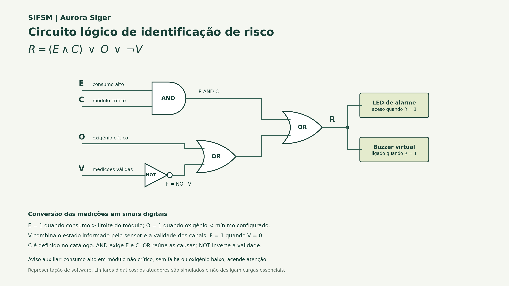

# Relatório técnico - Integração da Parte 2 ao SIFSM

## 1. Compatibilidade identificada

O projeto da Parte 1 organiza módulos, sensores individuais, leituras, alertas e manutenções em SQLite. `integracao.py` reserva o módulo `parte2_regras` e exige a função `executar(conn)`; o menu chama esse contrato na opção 6.

A primeira versão isolada da Parte 2 usava estações virtuais com consumo e oxigênio simultâneos. Conectá-la diretamente ao banco criaria falhas indevidas: a Central de Energia possui apenas um sensor de consumo, e a Habitação possui apenas um sensor de oxigênio. O adaptador agora respeita cada tipo, preservando os dados e as tabelas existentes.

## 2. Fluxo integrado

```text
main.py -> opção 6 -> integracao.executar_parte(conn, "2")
                         -> parte2_regras.executar(conn)
                            -> consultar sensores + módulos + última leitura
                            -> validar canais, unidade, data e estado
                            -> avaliar circuito booleano
                            -> organizar fila com min-heap
                            -> registrar alertas, quando solicitado
                               -> alertas + parte2_eventos
```

A consulta seleciona a última leitura por horário e ID. Sensores de umidade e temperatura continuam no CRUD, mas não são classificados pela regra de consumo/oxigênio. Não são criadas leituras fictícias para completar canais ausentes.

## 3. Regra, circuito e medidas

`R = (E AND C) OR O OR (NOT V)`. E representa consumo acima do limite; C vem de `modulos.critico`; O representa oxigênio abaixo do mínimo; V reúne validade da medição, estado ativo do sensor e coerência dos metadados. A porta NOT produz F=NOT V, a AND combina E e C, e portas OR reúnem as causas.



O núcleo puro enumera as 16 combinações das quatro entradas. R é zero apenas em (0,0,0,1), (0,1,0,1) e (1,0,0,1). Qualquer combinação com V=0 gera alarme. O aviso auxiliar registra consumo excessivo em módulo não crítico, sem ativar o alarme crítico se não houver outra causa.

O adaptador usa inicialmente 50 kWh por leitura de consumo e 19,5% de oxigênio, como parâmetros didáticos. Consumo exatamente no limite e oxigênio exatamente no mínimo não ativam os respectivos comparadores. Um valor em kW não é interpretado como kWh: essa conversão exigiria uma duração que o schema atual não informa. Os valores de consumo são tratados como energia de uma janela comparável; se a origem passar a fornecer medidor acumulado, a aquisição deverá calcular a diferença do intervalo.

Não são parâmetros certificados para um habitat real. O programa simula LED de alarme, buzzer e indicador de atenção, sem desligar cargas essenciais ou atuar sobre suporte à vida.

## 4. Estruturas de dados

Dicionários organizam sensores, IDs, últimas decisões e metadados consultados. Listas preservam o histórico da simulação e os resultados do banco. A fila utiliza `heapq`, com chave (prioridade, ordem_de_chegada, alerta); a inserção e a retirada têm custo O(log n), e consultar o primeiro custa O(1). Uma lista não ordenada precisaria ser percorrida para escolher cada próximo evento.

A prioridade calculada é 1 para oxigênio crítico, 2 para falha de medição ou sensor, 3 para excesso em módulo crítico e 4 para excesso em módulo não crítico. Empates preservam a ordem de chegada; no banco, os registros são carregados por data e ID. Listar a fila usa uma cópia e não remove os eventos. O vetor interno do heap não é uma lista totalmente ordenada.

Alertas manuais e alertas calculados permanecem distintos. Na fila persistida, alertas da Parte 2 usam sua prioridade exata; os demais usam o nível já cadastrado. Um alerta manual que descreva a mesma situação não é apagado nem marcado como resolvido por inferência.

## 5. Persistência e auditoria

As cinco tabelas originais foram mantidas. A tabela auxiliar `parte2_eventos` é criada ao registrar a análise e contém assinatura, sensor, leitura, alerta associado, prioridade e JSON da decisão. O alerta legível é inserido em `alertas`, ficando acessível no CRUD original.

A assinatura inclui os dados de origem e os parâmetros. Repetir a mesma análise não duplica o evento. Uma alteração via CRUD produz nova evidência se a nova situação exigir alerta. A normalização posterior de uma leitura não apaga eventos históricos, e uma reanálise não reabre automaticamente alertas que já foram resolvidos.

A gravação usa um SAVEPOINT. A análise e os inserts participam da mesma transação; uma falha de integridade reverte o lote. Se já houver uma transação do chamador, a Parte 2 não a confirma indevidamente. As chaves estrangeiras permitem que a exclusão no CRUD continue consistente, mantendo o JSON da evidência quando a leitura de origem é excluída.

## 6. Validação com os dados da Parte 1

O cenário original possui quatro módulos, quatro sensores, sete leituras, um alerta manual e uma manutenção. A análise dos tipos relevantes produziu:

| Origem | Evidência | Resultado |
| --- | --- | --- |
| SEN-ENE-01 / Central de Energia | Última leitura 3: 55,8 kWh | E=1, C=1, O=0, V=1, R=1; prioridade 3 |
| SEN-HAB-O2 / Habitação Principal | Última leitura 5: 20,4% | E=0, C=1, O=0, V=1, R=0 |
| SEN-AGR-UM | Sensor de umidade | Não aplicável à regra de energia/oxigênio |
| SEN-LAB-TP | Sensor de temperatura | Não aplicável à regra de energia/oxigênio |

A primeira gravação criou um alerta calculado. A segunda retornou zero novos e um já registrado. O alerta manual inicial permaneceu intacto, totalizando dois registros na tabela `alertas`. O histórico e os valores originais de leitura não foram modificados.

A demonstração usa o próprio schema e o script de dados de exemplo da Parte 1 em SQLite em memória. Não cria nem altera o banco de uso local. Os resultados podem ser reproduzidos com `python parte2_regras.py --demo` e conferidos em [execucao_sqlite.json](evidencias/parte2_sqlite/execucao_sqlite.json), [terminal_sqlite.txt](evidencias/parte2_sqlite/terminal_sqlite.txt) e [alertas_banco.csv](evidencias/parte2_sqlite/alertas_banco.csv).

O cenário JSON de 13 leituras foi preservado como demonstração adicional: quatro resultados normais, dois de atenção e sete críticos, com nove alertas. Ele exercita sensor inválido, medição ausente, limites exatos e causas simultâneas. Não foi importado automaticamente para as tabelas do grupo.

## 7. Testes e ajustes mínimos da Parte 1

Foram aprovados **44 testes**: os 26 testes do circuito, sensores e estruturas, mais 18 testes da integração com SQLite, CRUD e menu. O registro está em [evidencias/testes.txt](evidencias/testes.txt).

Os testes cobrem leitura dos dados publicados, canais individuais, alterações e exclusões via CRUD, sensor sem leitura ou inativo, unidade incompatível, data inválida, valor não finito, configuração de limites, deduplicação, manutenção da transação externa, rollback do lote, preservação de alerta manual, exclusão de resolvidos da fila e execução da opção 6 pelo menu original.

Em `main.py`, a inicialização ficou protegida por `if __name__ == "__main__"`, permitindo importação e a entrada padronizada `codigo_fonte.py` sem executar o menu no momento do import. Em `crud.converter`, entradas NaN/infinito passaram a ser recusadas como números não finitos. O adaptador também trata valores desse tipo caso tenham chegado ao banco por outro caminho.

## 8. Sustentabilidade, responsabilidade e limites

A regra evidencia o excesso energético sem apagar ocorrências e prioriza sinais de oxigênio crítico. Os critérios estão vinculados a funções operacionais, não a características pessoais da tripulação. A simulação não demonstra economia real de energia: não há medição física, comparação experimental de cenários nem atuação sobre equipamentos.

O operador decide quando registrar alertas e quando marcar uma ocorrência como resolvida no CRUD. O sistema não infere resolução física, não certifica segurança e não executa ações de suporte à vida. Os resultados podem ser usados como ferramenta determinística por futuras partes de agentes, preservando revisão humana e rastreabilidade.

O schema usa leituras pontuais e datas textuais no formato da Parte 1. A seleção da última leitura não oferece garantia de atualização em tempo real, sincronismo, detecção de ausência de pacotes ou consolidação de incidentes. Vários sensores de energia são avaliados individualmente; seus valores não são somados sem conhecer a topologia e a janela de medição. A tabela de limites por sensor e a consolidação de eventos seriam evoluções específicas para a integração futura.

As Partes 3 e 4 continuam como contratos aguardando seus módulos. Esta integração entrega as responsabilidades 1 e 2 funcionando em conjunto, sem afirmar que todas as exigências do SIFSM completo já estejam concluídas.
